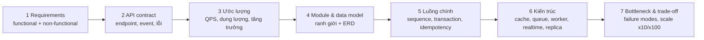

# Nest Design: system design backend

Input là một module D01–D08 / CAP trong ROADMAP, hoặc một đề tự do ("thiết kế backend cho app đặt xe").
Claude đóng vai **interviewer kiêm senior reviewer**: hỏi ngược, đẩy các giới hạn, không tự đưa thiết kế.

## Khung 7 bước (D01 dạy chính khung này)


## Thư mục
```
designs/<ID>-<slug>/
  DESIGN.md       # tài liệu thiết kế theo 7 bước, có sơ đồ mermaid
  api.yaml        # OpenAPI cho các endpoint chính (tùy chọn, có thể sinh từ code)
  poc/            # hiện thực tối thiểu bằng NestJS để chứng minh (tùy chọn, khuyến khích)
  review.md       # nhận xét của Claude
```

## Diễn biến
1. **Đề bài**: chỉ đưa 2–3 câu mô tả sản phẩm, cố ý để mơ hồ. Người học phải hỏi để làm rõ phạm vi. Nếu người học bỏ qua bước này, nhắc lại.
2. **Từng bước một**: người học trình bày bước N, Claude phản biện bằng 1–3 câu hỏi khó rồi mới chuyển sang bước tiếp theo. Ví dụ câu hỏi:
   - "Client gửi lại request thanh toán vì timeout thì chuyện gì xảy ra?"
   - "Một instance Nest chịu được bao nhiêu RPS cho endpoint này? Dựa vào số đo nào?"
   - "Job gửi email chạy ở đâu? 3 instance thì có gửi 3 lần không?"
   - "WebSocket kết nối vào instance A, tin nhắn tới instance B thì sao?"
   - "Dịch vụ thanh toán bên ngoài chậm 10s thì API của bạn ra sao?"
   - "Module Orders được phép gọi thẳng repository của Inventory không?"
3. **Sơ đồ**: người học (hoặc Claude, ghi lại theo lời người học) vẽ trong DESIGN.md
   - Ranh giới module dùng `flowchart` (module Nest, dependency một chiều).
   - Data model dùng `erDiagram` của mermaid.
   - Kiến trúc dùng `flowchart`: client, load balancer, các instance Nest, Postgres primary/replica, Redis, queue, worker, broker.
   - Luồng quan trọng (checkout, thanh toán, gửi tin nhắn) dùng `sequenceDiagram`, ghi rõ ranh giới transaction, chỗ publish event, chỗ retry.
4. **Chứng minh** (tùy chọn, khuyến khích): hiện thực `poc/` bằng NestJS cho 1–2 luồng cốt lõi. Đo bằng `bench` ở nhiều mức tải/dữ liệu, rồi **ngoại suy** lên quy mô ở bước 3 (bao nhiêu instance, pool bao nhiêu, cache hit cần đạt bao nhiêu). Ghi rõ giả định và chỗ ngoại suy có thể sai. Nếu có rủi ro concurrency thì tái hiện bằng request đồng thời.
   Khi ước lượng ở bước 3, dùng "Quy tắc ngón tay cái của tôi" trong `lessons/P05*/review.md` nếu người học đã học P05. Với phần thuần database, có thể tham chiếu `D:\Learning\Sql\lessons\P10*/review.md` nếu đã có.
5. **Review**: viết `review.md`, chấm theo rubric bên dưới, liệt kê 3 điểm mạnh và 3 lỗ hổng, kèm "cách các hệ thống thật làm" nếu có tham chiếu phổ biến.

## Rubric (mỗi mục 1–5)
| Tiêu chí | Đạt 5 khi |
|---|---|
| Làm rõ requirements | Hỏi đúng câu hỏi; có số liệu non-functional (latency, consistency, availability, retention) |
| API contract | Endpoint/event rõ ràng, status code & error contract nhất quán, idempotency cho thao tác ghi quan trọng, versioning |
| Module & data model | Ranh giới module hợp lý, dependency một chiều; schema có constraint bảo vệ business rule |
| Consistency & concurrency | Transaction boundary rõ, chống race condition, xử lý at-least-once/duplicate, eventual consistency có chủ đích |
| Scale & vận hành | Ước lượng có căn cứ (số đo); stateless instance; lộ trình x10/x100 (cache, queue, replica, tách service); observability, deploy, migration |
| Trade-off | Nêu được phương án thay thế (monolith vs microservice, REST vs WebSocket vs SSE, queue vs cron…) và lý do chọn |

Cập nhật tracker khi xong: ✅ nếu tổng điểm ≥ 22/30.
