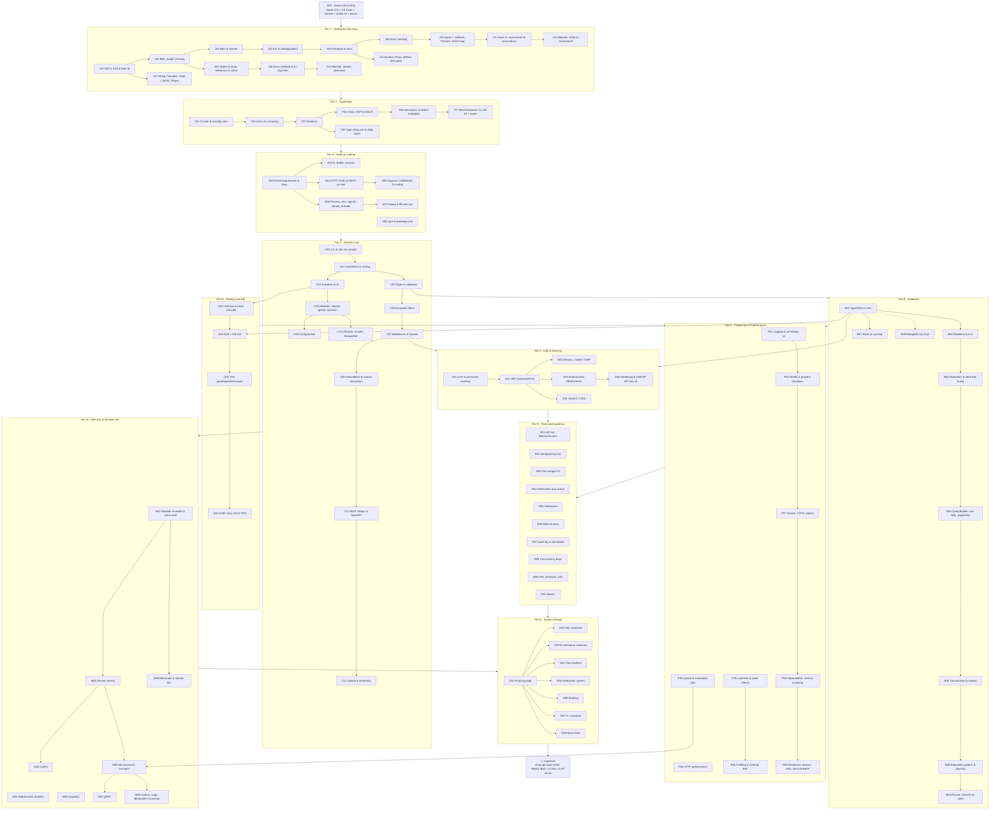
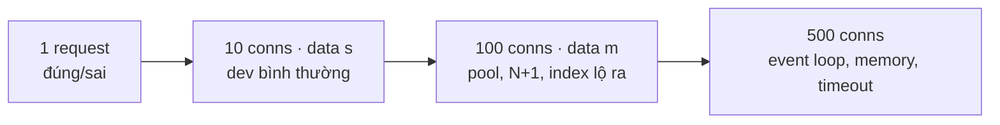
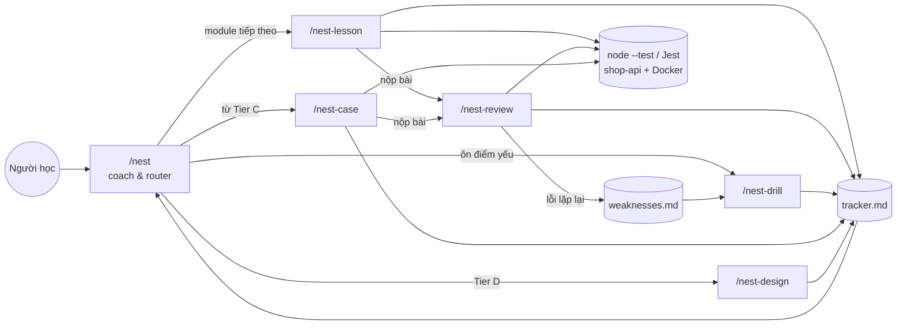
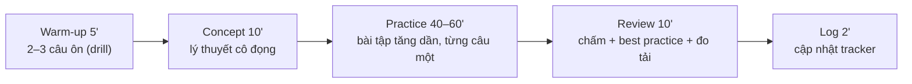

# Lộ trình NestJS / Backend Node.js

> Nguồn sự thật cho **module ID**. Các skill đọc file này để biết nội dung từng buổi.
> Mỗi module ≈ 1 buổi (60–90 phút). Module lớn có thể chia 2 buổi (`C07a`, `C07b`).
> Tổng ≈ 97 module (chưa tính drill/case) → học hằng ngày khoảng 4–5 tháng.

## Sơ đồ tổng thể

Ghi chú phụ thuộc chéo quan trọng:
`J10–J11 → N01, B05, P03` · `T06–T07 → C03, C08` · `N05 → C07` · `B05 → R02, R08` · `B07 → P04, R01` · `P03 → R04, R05, M08` · `C08 + A04 → R06` · `P05 → mọi câu hỏi tải từ Tier P trở đi`
Liên hệ với workspace SQL: `B04 ↔ SQL R02 (keyset)` · `B05 ↔ SQL P06–P08` · `B03 ↔ SQL R10` · `R08 ↔ SQL R08` · `R09 ↔ lỗi múi giờ đã gặp ở SQL`

## Trục tải & quy mô (xuyên suốt)

Một backend đúng chưa đủ. Cần biết nó chịu được bao nhiêu request đồng thời, với bao nhiêu dữ liệu, và vì sao gãy.

| Tier | Thứ được đo | Cách luyện |
|---|---|---|
| J / T | Đúng/sai, thứ tự thực thi | Bài "đoán output" thay cho đo tải. J10–J11 có đo thời gian chạy tuần tự vs song song |
| N | Event loop bị chặn | N01, N06: đo độ trễ khi có code đồng bộ nặng; so `worker_threads` |
| C | `bench` ở `1,10` conns | Làm quen với `bench`, chưa bắt buộc |
| B / A | `s` + `1,10,100` | Mỗi lesson ≥1 câu hỏi tải: dự đoán → `bench` → giải thích (N+1, thiếu index, pool) |
| P / R / M | `m` + `10,100,500` | P05 là module chuyên về hiệu ứng tải. Mọi fix hiệu năng phải có số đo trước/sau |
| D | Ước lượng + `bench` | Ước lượng QPS trên giấy, sau đó chứng minh bằng số đo thật |

## Sơ đồ hệ thống skill

## Nhịp một buổi học chuẩn

---

## Danh mục module

Cột **Pass** = tiêu chí để đánh dấu ✅. "8/10" nghĩa là 8 trên 10 bài qua hết test ẩn, dùng ≤ 2 hint.

### S · Setup
| ID | Chủ đề | Nội dung chính | Pass |
|---|---|---|---|
| S00 | Môi trường | Cài Node LTS (fnm/nvm-windows), npm, VS Code + ESLint/Prettier + debugger; `docker-compose` Postgres 18 (5434) + Redis (6380, để sẵn); `lessons/package.json` + `tsconfig.json` strict; `lessons/check.sh`; `bench/bench.sh` (autocannon) thử với 1 server `http` thuần; khái niệm terminal, PATH, `node`, REPL | `check.sh` chấm được 1 bài mẫu và `bench` xuất được bảng ở `1,10,100` conns |

### J · JavaScript nền tảng (runner: `node --test`, file `.js`)
| ID | Chủ đề | Nội dung chính | Pass |
|---|---|---|---|
| J01 | Giá trị & toán tử | primitive vs object, `typeof`, truthy/falsy, `==` vs `===`, coercion, `NaN`, `0.1 + 0.2`, `BigInt`, `??` vs `\|\|`, optional chaining `?.` | 8/10 |
| J02 | Biến & scope | `let`/`const`/`var`, block vs function scope, hoisting, TDZ, shadowing, global object, strict mode | 8/10 |
| J03 | Hàm & closure | declaration vs expression vs arrow, default/rest params, hàm là first-class, closure, IIFE, memoize, debounce/throttle, bẫy closure trong vòng lặp | 8/10 |
| J04 | `this` | 4 quy tắc binding, `call`/`apply`/`bind`, arrow giữ `this`, mất `this` khi truyền method làm callback (gốc của nhiều bug trong class/service) | 8/10 |
| J05 | Object & array | literal, shorthand, computed key, destructuring, spread/rest, reference vs value, shallow vs deep copy, `structuredClone`, `Object.freeze`, so sánh object | 8/10 |
| J06 | Array methods | `map/filter/reduce/find/some/every/flatMap`, `sort` với comparator (bẫy sort mặc định theo chuỗi), `toSorted`, immutability, group by bằng `reduce`/`Object.groupBy` | 8/10 |
| J07 | Builtins thực dụng | string methods, template literal, `Number`/`parseInt`/`toFixed` (bẫy làm tròn tiền), `Date` & timezone (bẫy `new Date('2026-10-01')` là UTC), `Intl`, `JSON.stringify/parse` (mất `Date`, `undefined`, `BigInt`), regex cơ bản | 8/10 |
| J08 | Prototype & class | prototype chain, `Object.create`, `class`, `constructor`, `extends`/`super`, getter/setter, `static`, `#private`, `instanceof` | 8/10 |
| J09 | Error handling | `try/catch/finally`, `throw`, `Error` vs throw chuỗi, custom error class, `error.cause`, `AggregateError`, fail fast vs nuốt lỗi | 8/10 |
| J10 | Async I | call stack, event loop, task vs microtask queue, callback & callback hell, `Promise` (state, `then/catch/finally`, chaining), promisify, bài đoán thứ tự log | 8/10 + đoán đúng ≥ 4/5 bài thứ tự log |
| J11 | Async II | `async/await`, lỗi trong async, tuần tự vs song song, `Promise.all/allSettled/race/any`, giới hạn concurrency (tự viết `pLimit`), timeout, `AbortController`, retry với backoff | 8/10 + đo thời gian tuần tự vs song song |
| J12 | Modules | ESM (`import`/`export`, default vs named) vs CommonJS (`require`/`module.exports`), `"type": "module"`, `.mjs/.cjs`, circular import, top-level await, dynamic `import()` | 8/10 |
| J13 | Collections & iteration | `Map`/`Set`/`WeakMap`, khi nào dùng thay object/array, iterator protocol, generator, `for…of`, async iterator & `for await` | 8/10 |
| J14 | Metaprogramming | `Symbol`, property descriptor (`Object.defineProperty`), `Proxy`, `Reflect` — nền cho decorator & DI ở Tier T | 6/8 |

### T · TypeScript (runner: `tsc --noEmit` + `node --test`)
| ID | Chủ đề | Nội dung chính | Pass |
|---|---|---|---|
| T01 | Cơ bản & tooling | type annotation vs inference, primitive/array/tuple/object type, `any` vs `unknown` vs `never`, `tsconfig` (`strict`, `target`, `module`, `outDir`), `tsc` vs `tsx` vs SWC, type stripping của Node, source map & debug | 8/10, `tsc` sạch |
| T02 | Union & narrowing | union/intersection, literal type, narrowing (`typeof`, `in`, `instanceof`), type guard tự viết, discriminated union, exhaustive check với `never` | 8/10 |
| T03 | Generics | generic function/interface/class, constraint `extends`, default type param, `keyof` trong generic, viết `Result<T, E>` | 8/10 |
| T04 | Class, OOP & SOLID | access modifier, parameter property, `readonly`, abstract class, `implements`, structural typing; SOLID và design pattern hay gặp trong Nest (strategy, factory, adapter, DI) | 8/10 |
| T05 | Type nâng cao | `keyof`, `typeof`, indexed access, mapped type, conditional type, `infer`, template literal type, `Partial/Required/Pick/Omit/Record/ReturnType/Awaited`, bài tập type-level (kiểm bằng `@ts-expect-error`) | 6/8 |
| T06 | Decorators & metadata | class/method/property/parameter decorator (legacy `experimentalDecorators` — Nest dùng loại này) vs TC39 decorators, decorator factory, `emitDecoratorMetadata`, `reflect-metadata`, `design:paramtypes` | 6/8 |
| T07 | Mini-framework | Tự viết bằng TS: `@Injectable` + container resolve constructor theo `design:paramtypes`, singleton scope, `@Controller`/`@Get` + router trên `http` thuần. Hiểu Nest "làm phép" thế nào trước khi dùng Nest | Mini-framework chạy được, qua hết test |

### N · Node.js runtime
| ID | Chủ đề | Nội dung chính | Pass |
|---|---|---|---|
| N01 | Event loop của Node | phases (timers, poll, check, close), `process.nextTick` vs `setImmediate` vs `setTimeout`, libuv thread pool (`crypto`, `fs`, `dns`), chặn event loop bằng code đồng bộ — đo bằng `perf_hooks.monitorEventLoopDelay` | 8/10 + 1 thí nghiệm đo lag |
| N02 | npm | `package.json`, semver (`^`, `~`), lockfile, `dependencies` vs `devDependencies`, scripts, `npx`, `npm ci`, audit, peer deps | 8/10 |
| N03 | File & streams | `fs/promises`, `path`, `Buffer` & encoding, stream Readable/Writable/Transform, `pipeline`, backpressure, xử lý file CSV lớn mà không tràn RAM | 8/10 + đo RAM đọc cả file vs stream |
| N04 | HTTP thuần | module `http`, request/response, method, status code, header, body parsing, content-type, CORS là gì, REST cơ bản, test bằng `curl`; tự viết router nhỏ | 8/10 |
| N05 | Express | middleware chain & `next()`, router, error middleware, `express.json()`, so sánh với Fastify; Express chính là platform mặc định bên dưới Nest | 8/10 |
| N06 | Process & concurrency | `process.env`, `.env`, exit code, signal (`SIGTERM`, `SIGINT`), graceful shutdown, `child_process`, `worker_threads` cho CPU-bound, `cluster` | 8/10 + đo trước/sau khi dời việc nặng sang worker |
| N07 | Debug & lỗi toàn cục | VS Code debugger, `--inspect`, breakpoint trong async, `unhandledRejection`/`uncaughtException`, heap snapshot cơ bản, log có cấu trúc | Debug được 3 bug cài sẵn |

### C · NestJS Core (làm trong `shop-api/`, chấm bằng e2e test ẩn)
| ID | Chủ đề | Nội dung chính | Pass |
|---|---|---|---|
| C01 | CLI & cấu trúc | `nest new shop-api`, cấu trúc thư mục, `main.ts`/bootstrap, module/controller/service, `nest g resource`, chạy watch + debug, tổng quan request lifecycle | `shop-api` chạy + endpoint đầu tiên qua test |
| C02 | Controllers | `@Get/@Post/...`, `@Param/@Query/@Body/@Headers`, DTO, `@HttpCode`, `@Header`, `@Redirect`, route wildcard, versioning, status code đúng chuẩn REST | 8/10 |
| C03 | Providers & DI | `@Injectable`, constructor injection, custom provider (`useValue/useClass/useFactory/useExisting`), injection token, `@Inject`, `@Optional`, circular dependency & `forwardRef` — đối chiếu với mini-framework T07 | 8/10 |
| C04 | Modules | feature module, `exports`/`imports`, shared module, `@Global`, dynamic module (`forRoot`/`forRootAsync`/`register`), `ConfigurableModuleBuilder` | 6/8 |
| C05 | Pipes & validation | built-in pipes (`ParseIntPipe`, `ParseUUIDPipe`…), `ValidationPipe` (`whitelist`, `forbidNonWhitelisted`, `transform`), class-validator/class-transformer, nested DTO, custom pipe, `PartialType/PickType` | 8/10 |
| C06 | Exception filters | `HttpException` & các lớp con, format lỗi thống nhất (RFC 9457 problem details), custom filter, `@Catch()` toàn cục, map lỗi domain → HTTP | 6/8 |
| C07 | Middleware & Guards | middleware (class & functional, `forRoutes`), guard & `canActivate`, `ExecutionContext`, global vs controller vs route scope | 6/8 |
| C08 | Interceptors & decorators | interceptor (logging, transform response, timeout, cache) với RxJS cơ bản, `SetMetadata` / `Reflector.createDecorator`, `createParamDecorator`, `applyDecorators`; **thứ tự đầy đủ** middleware → guard → interceptor → pipe → handler → interceptor → filter | 6/8 + vẽ đúng sơ đồ lifecycle |
| C09 | Configuration | `@nestjs/config`, `.env` theo môi trường, validate env bằng schema khi khởi động, `registerAs` namespace, config có kiểu | 6/8 |
| C10 | Lifecycle & scopes | `onModuleInit`, `onApplicationBootstrap`, `enableShutdownHooks`, async provider, scope DEFAULT/REQUEST/TRANSIENT và chi phí của REQUEST scope, `ModuleRef`, lazy-loading module | 6/8 + đo `bench` DEFAULT vs REQUEST scope |
| C11 | REST design & OpenAPI | resource naming, status code, pagination/filter contract, error contract, `@nestjs/swagger` + CLI plugin, versioning & deprecation | API của `shop-api` có Swagger đầy đủ, review đạt |
| C12 | Upload & streaming | Multer (`FileInterceptor`), `ParseFilePipe` + validator, giới hạn kích thước, `StreamableFile`, tải file lớn bằng stream | 6/8 |

### Q · Testing (xen kẽ, bắt đầu sau C03)
| ID | Chủ đề | Nội dung chính | Pass |
|---|---|---|---|
| Q01 | Unit test | Jest cơ bản, `Test.createTestingModule`, mock provider (`useValue`, `jest.fn`), `overrideProvider`, test service có dependency | Viết test cho 3 service, coverage nhánh chính |
| Q02 | E2E & DB | supertest, `INestApplication`, DB test riêng (Testcontainers hoặc schema riêng), fixture & dọn dữ liệu, test chạy song song không giẫm nhau | Bộ e2e cho 1 module xanh ổn định 3 lần chạy |
| Q03 | Test thành phần Nest | test guard/pipe/interceptor/filter riêng lẻ, mock `ExecutionContext`, fake timers, test code async và lỗi | 6/8 |
| Q04 | Chiến lược | test pyramid, cái gì đáng test, TDD 1 tính năng nhỏ, test flaky, coverage có ý nghĩa vs coverage cho đẹp | Làm TDD 1 tính năng, review đạt |

### B · Database (Postgres + TypeORM là chính; ORM khác ở B08)
| ID | Chủ đề | Nội dung chính | Pass |
|---|---|---|---|
| B01 | TypeORM cơ bản | `TypeOrmModule.forRootAsync`, entity, column type (tiền dùng `numeric`, thời gian dùng `timestamptz`), repository CRUD, `synchronize` vs migration, log SQL sinh ra | 8/10 |
| B02 | Relations & N+1 | 1-1, 1-n, n-n, `JoinColumn`, eager vs lazy, cascade, `relations`/`leftJoinAndSelect`, phát hiện N+1 bằng log SQL | 8/10 + đo `bench` trước/sau sửa N+1 |
| B03 | Migrations & seed | `migration:generate/run/revert`, migration an toàn (thêm cột NOT NULL, đổi tên cột), seed theo tham số N, **sinh bậc thang `shop_xs/s/m`** | Bậc thang dữ liệu sinh được, migration chạy/lùi được |
| B04 | QueryBuilder & SQL | QueryBuilder, raw SQL có tham số (chống SQL injection), projection/DTO, aggregate, offset vs keyset pagination | 8/10 + `bench` offset vs keyset ở `m` |
| B05 | Transactions & locking | `DataSource.transaction`, `QueryRunner`, isolation level, optimistic lock (`@VersionColumn`), pessimistic lock (`setLock`), truyền transaction qua nhiều service (CLS), deadlock & retry | Tái hiện & sửa 1 lost update bằng 2 request đồng thời |
| B06 | Layering | repository pattern, tách domain model khỏi entity, mapper, service mỏng hay dày, khi nào **không** cần thêm lớp | Refactor 1 module, review đạt |
| B07 | Redis & caching | `@nestjs/cache-manager` + Redis, cache-aside, TTL, invalidation, cache key, cache stampede, cache negative | 6/8 + `bench` có/không cache |
| B08 | ORM khác | làm lại 1 module bằng Prisma (hoặc Drizzle), so sánh type safety, migration, query sinh ra, hiệu năng | Bảng so sánh có số đo |
| B09 | MongoDB (tùy chọn) | Mongoose schema, `@nestjs/mongoose`, embed vs reference, khi nào chọn document DB | 6/8 |

### A · Auth & Security
| ID | Chủ đề | Nội dung chính | Pass |
|---|---|---|---|
| A01 | User & password | module users, hash bằng argon2/bcrypt (vì sao không SHA-256), đăng ký/đăng nhập, không lộ password hash trong response (`ClassSerializerInterceptor`/`@Exclude`) | 8/10 |
| A02 | JWT | access + refresh token, ký/verify, hết hạn, rotation, phát hiện reuse, thu hồi; Passport strategy vs guard tự viết | Luồng login → refresh → logout qua hết test |
| A03 | Session & cookie | cookie `httpOnly/Secure/SameSite`, session lưu Redis, CSRF, JWT vs session — trade-off | 6/8 |
| A04 | Authorization | RBAC bằng guard + decorator `@Roles`, kiểm tra quyền sở hữu resource, ABAC với CASL, lỗi IDOR | Chặn đúng mọi truy cập chéo trong test |
| A05 | OAuth2 / OIDC | authorization code + PKCE, đăng nhập Google, liên kết tài khoản, state & nonce | Đăng nhập Google chạy được |
| A06 | Hardening | `helmet`, CORS đúng cách, `@nestjs/throttler`, giới hạn body, mass assignment, SQL injection, secrets, OWASP API Security Top 10 | Audit `shop-api` theo checklist, sửa hết lỗi mức cao |

### P · Production & Performance (mặc định data `m`)
| ID | Chủ đề | Nội dung chính | Pass |
|---|---|---|---|
| P01 | Logging | `Logger` của Nest vs `nestjs-pino`, log JSON có cấu trúc, log level, correlation/request id bằng `AsyncLocalStorage`, không log dữ liệu nhạy cảm | Mọi log của 1 request truy được bằng 1 id |
| P02 | Health & shutdown | `@nestjs/terminus` (liveness/readiness, DB, Redis), graceful shutdown: ngừng nhận request, chờ request đang chạy, đóng pool | Kill trong lúc `bench` mà không mất request |
| P03 | Queue & jobs | BullMQ (`@nestjs/bullmq`), producer/consumer, retry & backoff, job idempotent, dead letter, concurrency; `@nestjs/schedule` (cron) và bẫy chạy nhiều instance | 6/8 |
| P04 | HTTP performance | Fastify adapter, compression, HTTP caching (ETag, `Cache-Control`), serialize nhanh, kích thước payload | `bench` Express vs Fastify + 2 tối ưu có số đo |
| P05 | Scale effects (2 buổi: P05a, P05b) | **P05a · Tải:** RPS/p99 theo số connection, điểm bão hòa, event loop lag, connection pool DB (pool nhỏ → hàng đợi, pool lớn → DB quá tải), timeout chuỗi. **P05b · Dữ liệu:** cùng endpoint ở `xs → s → m`, N+1 và thiếu index bùng nổ theo N, `JSON.stringify` payload lớn chặn loop, phân trang offset sâu | Mỗi thí nghiệm có dự đoán trước, đúng xu hướng ≥ 70%, giải thích được mọi điểm gãy bằng số đo |
| P06 | Profiling & memory | `--cpu-prof`, flame graph (clinic/0x), heap snapshot so sánh, tìm memory leak (closure, cache không giới hạn, listener) | Tìm & sửa 1 leak + 1 hot path có số đo |
| P07 | Docker & deploy | Dockerfile multi-stage, image nhỏ, chạy user non-root, migration lúc deploy, env/secret, GitHub Actions (lint → test → build), docker compose prod-like | `shop-api` chạy từ image, CI xanh |
| P08 | Observability | metrics Prometheus (RED: rate/errors/duration), OpenTelemetry tracing qua HTTP → DB → queue, dashboard cơ bản | Trace được 1 request end-to-end |
| P09 | Resilience | timeout cho mọi call ra ngoài, retry có jitter, circuit breaker, bulkhead, rate limit gọi bên thứ ba, fallback | Mô phỏng dịch vụ ngoài chậm mà API vẫn sống |

### R · Real-world patterns
| ID | Chủ đề | Nội dung chính | Pass |
|---|---|---|---|
| R01 | API danh sách | filter/sort/search an toàn (whitelist field), cursor pagination, tổng số bản ghi có cần không | `bench` ở `m` đạt ngưỡng tự đặt |
| R02 | Idempotency | `Idempotency-Key` cho POST thanh toán, lưu kết quả, xử lý request trùng đang chạy dở | Gửi trùng 50 request đồng thời chỉ tạo 1 kết quả |
| R03 | File storage | S3 / MinIO, presigned URL upload/download, xử lý ảnh qua queue, dọn file mồ côi | 6/8 |
| R04 | Notification | email qua queue (template, retry, giới hạn tần suất), outbox nhẹ để không gửi khi transaction rollback | 6/8 |
| R05 | Webhooks | nhận webhook (verify chữ ký, idempotent, trả 2xx nhanh rồi xử lý nền), gửi webhook (retry, backoff, ký HMAC) | 6/8 |
| R06 | Multi-tenancy | tenant id qua guard + CLS, filter tự động ở tầng repository, RLS của Postgres, tránh rò dữ liệu chéo | Test chéo tenant đều bị chặn |
| R07 | Audit & soft delete | entity subscriber / interceptor ghi audit, `@DeleteDateColumn`, unique khi có soft delete | 6/8 |
| R08 | Concurrency bugs | oversell tồn kho, double booking, double charge, counter hot row — tái hiện bằng `bench` đồng thời rồi sửa (lock, constraint, atomic update, queue) | Tái hiện & sửa 3 bug |
| R09 | Tiền, giờ, i18n | tiền không dùng float (`numeric` + decimal lib), timezone end-to-end (DB `timestamptz` → API ISO 8601 → client), i18n message, định dạng VN | 6/8 |
| R10 | Search | Postgres full-text (`tsvector`, `unaccent` cho tiếng Việt) qua TypeORM, `pg_trgm`, khi nào cần Elasticsearch/Meilisearch | Search đúng + có index + số đo |

### M · Kiến trúc & hệ phân tán
| ID | Chủ đề | Nội dung chính | Pass |
|---|---|---|---|
| M01 | Modular monolith | ranh giới module, dependency rule, clean/hexagonal (port & adapter) ở mức vừa đủ, DDD-lite (aggregate, value object), khi nào là over-engineering | Vẽ & áp dụng ranh giới cho `shop-api` |
| M02 | Domain events | `@nestjs/event-emitter`, event đồng bộ vs bất đồng bộ, tách side effect khỏi use case, lỗi trong listener | 6/8 |
| M03 | CQRS | `@nestjs/cqrs` (command, query, event, saga), khi nào đáng dùng, read model riêng | 6/8 |
| M04 | WebSockets | gateway, Socket.IO, room, auth khi kết nối, scale nhiều instance bằng Redis adapter, SSE như phương án nhẹ | Chat nhỏ chạy 2 instance |
| M05 | GraphQL | `@nestjs/graphql` code-first, resolver, DataLoader chống N+1, phân quyền field, so với REST | 6/8 + số đo có/không DataLoader |
| M06 | Microservices | `@nestjs/microservices`: TCP, Redis, RabbitMQ, Kafka; message pattern vs event pattern, hybrid app, timeout & lỗi giữa service | 2 service giao tiếp qua RabbitMQ |
| M07 | gRPC | proto, codegen, streaming, so với REST/message broker | 6/8 |
| M08 | Distributed patterns | transactional outbox, idempotent consumer, saga (orchestration vs choreography), eventual consistency, at-least-once | Outbox + consumer idempotent chạy đúng khi kill giữa chừng |
| M09 | Monorepo | Nest monorepo mode hoặc Nx, shared library (DTO, contract), build/test chỉ phần bị ảnh hưởng | 6/8 |

### D · System Design (backend)
| ID | Chủ đề | Trọng tâm | Pass |
|---|---|---|---|
| D01 | Phương pháp | requirements → API contract → ước lượng tải → module & data model → luồng chính → kiến trúc → bottleneck & trade-off | Áp dụng được checklist |
| D02 | URL shortener | sinh ID, hot read, cache, rate limit, analytics click qua queue | Bản thiết kế + review |
| D03 | E-commerce checkout | giỏ hàng, giữ tồn kho, thanh toán idempotent, state machine đơn hàng, saga | 〃 |
| D04 | Chat realtime | WebSocket nhiều instance, lưu tin nhắn, unread count, presence | 〃 |
| D05 | Notification system | đa kênh (email/push/SMS), ưu tiên, retry, chống gửi trùng, user preference | 〃 |
| D06 | Booking | giữ chỗ tạm có hạn, chống double booking, hàng chờ khi mở bán | 〃 |
| D07 | Ví / payment | ledger double-entry, webhook cổng thanh toán, đối soát | 〃 |
| D08 | News feed | fan-out on write/read, cache feed, counter, phân trang | 〃 |
| CAP | Capstone | hoàn thiện `shop-api` (hoặc 1 đề D*): auth, test, queue, observability, Docker + CI, báo cáo `bench` | Demo + review |
