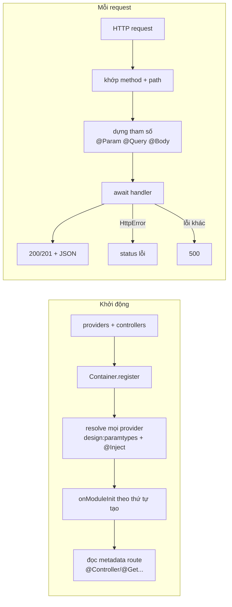

# T07 · Mini-framework: tự viết DI container + router (NestJS thu nhỏ)

Buổi này không có lý thuyết mới — bạn **ráp** mọi thứ của Tier J/T thành một framework ~300 dòng: decorator (T06), metadata (J14), class & interface (T04), generics (T03), async (J11), HTTP (sẽ học kỹ ở N04). Sau buổi này, NestJS chỉ còn là "phiên bản đầy đủ của thứ mình đã viết".

## Mục tiêu: sau buổi này bạn làm được
- Giải thích Nest tạo object thế nào: đọc `design:paramtypes` + `@Inject` → resolve đệ quy → cache singleton.
- Giải thích lỗi "Nest can't resolve dependencies", "circular dependency", vì sao cần `@Injectable()`.
- Giải thích request đi từ HTTP tới method controller ra sao: khớp route → lấy tham số (`@Param/@Query/@Body`) → gọi handler → map lỗi ra status.

---

## Kiến trúc cần dựng


## Đối chiếu với NestJS
| Mini-nest (bạn viết) | NestJS |
|---|---|
| `Container` | `NestContainer` / `Injector` / `ModuleRef` |
| `Injectable({ scope })` | `@Injectable({ scope: Scope.TRANSIENT })` |
| `{ provide, useValue / useClass / useFactory, inject }` | custom provider y hệt (C03) |
| lỗi "Circular dependency: A -> B -> A" | gợi ý dùng `forwardRef()` |
| `@Controller/@Get/@Param/@Query/@Body` | y hệt (C02) |
| `HttpError(status, message)` | `HttpException` (C06) |
| `onModuleInit()` | lifecycle hook (C10) |
| `createApp().listen()` | `NestFactory.create(AppModule).listen()` |
Những gì Nest có thêm: module (phạm vi provider), middleware/guard/interceptor/pipe/filter (C05–C08), REQUEST scope, platform Express/Fastify.

## Gợi ý chia file
```
answers/mini-nest/
  container.ts    # Token, Provider, Injectable, Inject, Container
  router.ts       # Controller, Get/Post/Put/Delete, Param/Query/Body, HttpError
  app.ts          # createApp: handle() + listen()
  index.ts        # export * từ 3 file trên
```
Mọi test import từ `answers/mini-nest/index.js`. Làm lần lượt ex01 → ex08: mỗi bài thêm một tính năng, bài sau vẫn phải giữ bài trước chạy đúng.

## Bài tập
Xem `exercises.md`. Chấm: `bash lessons/check.sh lessons/T07-mini-framework NN`.
